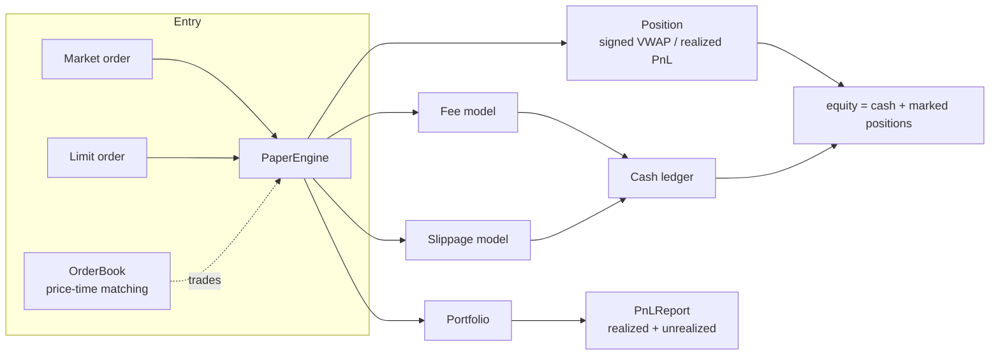

<p align="center">
  
</p>

<h1 align="center">Paper Trading Engine</h1>

<p align="center">
  <strong>A fast, dependency-light simulated execution engine for Python — market &amp; limit orders, partial fills, fees, slippage, shorts, multi-account portfolios, and PnL reporting.</strong><br>
  Build, test, and validate trading strategies against a deterministic fill model — no live market, no real money.
</p>

<p align="center">
  <em>Built and maintained by <a href="https://viprasol.com">Viprasol Tech</a> — Fintech Experts. Full-Stack Builders.</em>
</p>

<p align="center">
  <a href="https://github.com/Viprasol-Tech/paper-trading-engine/actions/workflows/ci.yml"></a>
  <a href="LICENSE"></a>
  
  
  
  
  <a href="https://t.me/viprasol_help"></a>
  <a href="https://github.com/Viprasol-Tech/paper-trading-engine/stargazers"></a>
</p>

---

> ## ⚠️ Disclaimer
> This software is for **educational purposes only** and is **not financial advice**. It simulates order execution and does **not** connect to any live market. Trading involves substantial risk, including the **total loss of capital**. Simulated results are **not** indicative of future performance. **Use at your own risk** — Viprasol Tech assumes no responsibility for your trading results.

---

## ✨ Features

- 💵 **Cash-settled engine** — `PaperEngine(starting_cash, ...)` settles fills against a cash ledger.
- 🎯 **Market & limit orders** — limit orders detect marketability, give the taker price improvement, and rest when not marketable.
- 🧩 **Partial fills** — drive a resting order to completion via `fill_resting_order(...)`; track `filled_qty`, `remaining`, and `status`.
- 💸 **Pluggable fee models** — `ZeroFee`, `PercentageFee`, `PerShareFee` (with a per-order minimum), `FlatFee`.
- 🌊 **Slippage models** — `NoSlippage`, `PercentageSlippage`, `FixedSlippage` adjust the effective fill price.
- 📉 **Long *and* short** — signed positions with average-cost accounting; positions reduce, close, and flip through zero.
- 🧮 **Realized + unrealized PnL** — per symbol and per account, plus `total_pnl = realized + unrealized − fees`.
- 🏦 **Multi-account portfolios** — group named accounts and roll them up into a single `PnLReport`.
- 📖 **Order book helper** — a price-time-priority `OrderBook` with partial fills, spread/mid/depth, and cancellation.
- 🖥️ **Rich CLI** — `demo`, `report`, and `book` subcommands render tables with [Rich](https://github.com/Textualize/rich).
- 🛡️ **Safe by construction** — rejects oversells (when shorting is off), unaffordable buys, and bad inputs.
- ⚙️ **Modern tooling** — ruff, mypy (strict), pytest, GitHub Actions CI; only `pydantic`, `typer`, `rich`.

## 🚀 Quickstart

```bash
git clone https://github.com/Viprasol-Tech/paper-trading-engine.git
cd paper-trading-engine
python -m pip install -e ".[dev]"

paper-trading-engine demo                 # market + limit order flow, PnL & equity
paper-trading-engine report               # two-account portfolio PnL report
paper-trading-engine book                 # order book matching with partial fills
paper-trading-engine demo --fee-rate 0.0 --starting-cash 50000 --slippage 0.002
```

## 🧩 Use it in code

```python
from paper_trading_engine import PaperEngine, PercentageFee, PercentageSlippage, Side

engine = PaperEngine(
    starting_cash=10_000.0,
    fee_model=PercentageFee(0.001),         # 10 bps commission
    slippage_model=PercentageSlippage(0.0005),  # 5 bps adverse slippage
    allow_short=True,
)

engine.submit_market_order("AAPL", Side.BUY, qty=10.0, price=100.0)
engine.submit_market_order("AAPL", Side.BUY, qty=10.0, price=110.0)   # avg entry -> ~105
engine.submit_market_order("AAPL", Side.SELL, qty=5.0, price=120.0)   # realizes PnL

marks = {"AAPL": 130.0}
print(engine.position("AAPL").avg_price)   # volume-weighted entry
print(engine.realized_pnl())               # booked on the sell
print(engine.unrealized_pnl(marks))        # open PnL vs. mark
print(engine.total_pnl(marks))             # realized + unrealized - fees
print(engine.equity(marks))                # cash + marked positions
```

### Limit orders & partial fills

```python
# A non-marketable limit rests; fill it as liquidity arrives.
order = engine.submit_limit_order("MSFT", Side.BUY, qty=10.0, limit_price=95.0, market_price=100.0)
assert order.status.value == "new"          # rests
engine.fill_resting_order(order, qty=4.0, price=95.0)   # partial
engine.fill_resting_order(order, qty=6.0, price=94.0)   # completes
assert order.status.value == "filled"
```

### Multi-account portfolios

```python
from paper_trading_engine import Portfolio, Side

pf = Portfolio()
mom = pf.open_account("momentum", starting_cash=20_000.0, fee_rate=0.001)
rev = pf.open_account("mean-reversion", starting_cash=15_000.0, allow_short=True)

mom.submit_market_order("AAPL", Side.BUY, qty=50.0, price=100.0)
rev.submit_market_order("TSLA", Side.SELL, qty=10.0, price=250.0)  # short

report = pf.report({"AAPL": 120.0, "TSLA": 240.0})
print(report.total_equity, report.total_realized_pnl, report.total_unrealized_pnl)
```

### Order book matching

```python
from paper_trading_engine import OrderBook, Side

ob = OrderBook("AAPL")
ob.add_limit(Side.SELL, price=101.0, qty=5.0, order_id="ask-1")
ob.add_limit(Side.SELL, price=102.0, qty=10.0, order_id="ask-2")

trades = ob.add_limit(Side.BUY, price=102.0, qty=8.0, order_id="taker")
# -> 5 @ 101 (ask-1) + 3 @ 102 (ask-2); price-time priority, partial fills
print(ob.best_bid(), ob.best_ask(), ob.spread(), ob.mid_price())
```

## 🏗️ Architecture



## 📚 API at a glance

| Component | Symbol | What it does |
|-----------|--------|--------------|
| Engine | `PaperEngine` | Settles market/limit fills, cash, positions, PnL |
| Order entry | `submit_market_order` / `submit_limit_order` | Place orders (with slippage / marketability) |
| Partial fills | `fill_resting_order` / `cancel_order` / `open_orders` | Advance or cancel resting orders |
| Fees | `ZeroFee` `PercentageFee` `PerShareFee` `FlatFee` | Commission models |
| Slippage | `NoSlippage` `PercentageSlippage` `FixedSlippage` | Effective-price adjustment |
| Positions | `Position` | Signed VWAP entry, realized & unrealized PnL |
| PnL | `realized_pnl` / `unrealized_pnl` / `total_pnl` / `equity` | Account-level reporting |
| Portfolios | `Portfolio` → `PnLReport` | Multi-account roll-up |
| Matching | `OrderBook` → `Trade` | Price-time-priority limit order book |

## 🗺️ Roadmap

- [x] Market-order engine with cash, fees, and positions
- [x] Volume-weighted average entry + realized PnL
- [x] Mark-to-market equity and per-symbol reporting
- [x] Limit orders + partial fills + order cancellation
- [x] Pluggable fee and slippage models
- [x] Short selling and signed-position accounting
- [x] Multi-account portfolios + consolidated PnL report
- [x] Price-time-priority order book matching helper
- [ ] Stop / stop-limit / bracket order types
- [ ] Margin and borrow-cost accounting for shorts
- [ ] CSV/JSON fill export and a vectorized backtest harness

## ❓ FAQ

**Does this connect to a real broker or exchange?**
No. It is a pure simulator — you supply prices, it models fills, cash, and PnL deterministically.

**How is the average entry price calculated?**
Volume-weighted across same-direction fills. Reducing or closing realizes PnL against that average; oversized opposite trades flip the position and re-open at the new price.

**Can I model shorts?**
Yes — construct the engine with `allow_short=True`. Short positions carry a negative quantity and profit as the mark falls below the average entry.

**Why are fees and slippage separate models?**
So you can compose them: e.g. a `PerShareFee` with a per-order minimum plus `PercentageSlippage` for adverse selection, swapped independently per account.

## 🤝 Contributing

PRs welcome — see [CONTRIBUTING.md](CONTRIBUTING.md) and our [Code of Conduct](CODE_OF_CONDUCT.md).
Run the checks locally before opening a PR:

```bash
ruff check . && ruff format --check . && mypy src && pytest -q
```

## Contact — Viprasol Tech Private Limited

- Website: [viprasol.com](https://viprasol.com)
- Email: [support@viprasol.com](mailto:support@viprasol.com)
- Telegram: [t.me/viprasol_help](https://t.me/viprasol_help) | WhatsApp: +91 96336 52112
- GitHub: [@Viprasol-Tech](https://github.com/Viprasol-Tech) | [LinkedIn](https://www.linkedin.com/in/viprasol/) | X [@viprasol](https://twitter.com/viprasol)

## License

[MIT](LICENSE) (c) 2025 Viprasol Tech Private Limited
