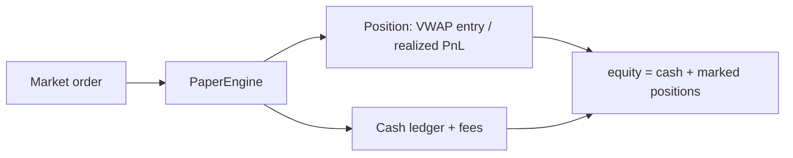

<p align="center">
  
</p>

<h1 align="center">Paper Trading Engine</h1>

<p align="center">
  <strong>Simulated paper-trading / execution engine with positions and PnL — in Python.</strong><br>
  Submit market orders, track volume-weighted entries, realize PnL on exits, and mark equity to market.
</p>

<p align="center">
  <em>Built and maintained by <a href="https://viprasol.com">Viprasol Tech</a> — Fintech Experts. Full-Stack Builders.</em>
</p>

<p align="center">
  <a href="https://github.com/Viprasol-Tech/paper-trading-engine/actions/workflows/ci.yml"></a>
  <a href="LICENSE"></a>
  
  <a href="https://t.me/viprasol_help"></a>
  <a href="https://github.com/Viprasol-Tech/paper-trading-engine/stargazers"></a>
</p>

---

> ## ⚠️ Disclaimer
> This software is for **educational purposes only** and is **not financial advice**. It simulates order execution and does **not** connect to any live market. Trading involves substantial risk, including the **total loss of capital**. Simulated results are **not** indicative of future performance. **Use at your own risk** — Viprasol Tech assumes no responsibility for your trading results.

---

## ✨ Features

- 💵 **Cash-settled engine** — `PaperEngine(starting_cash, fee_rate)` fills market orders instantly.
- 📈 **Average-cost positions** — buys update a volume-weighted average entry price.
- 🧮 **Realized PnL** — sells book PnL against the average entry, tracked per symbol.
- 🏦 **Mark-to-market equity** — `equity(mark_prices)` = cash + marked open positions.
- 💸 **Fee modelling** — a proportional fee reduces cash on every fill.
- 🛡️ **Safe by construction** — rejects oversells, unaffordable buys, and bad inputs.
- 🖥️ **CLI** — `paper-trading-engine demo` runs a sample order flow end to end.
- ⚙️ **Modern tooling** — ruff, mypy (strict), pytest, GitHub Actions CI.

## 🚀 Quickstart

```bash
git clone https://github.com/Viprasol-Tech/paper-trading-engine.git
cd paper-trading-engine
python -m pip install -e ".[dev]"

# Run a sample order sequence and print positions, PnL, and equity:
paper-trading-engine demo
paper-trading-engine demo --fee-rate 0.0 --starting-cash 50000
```

## 🧩 Use it in code

```python
from paper_trading_engine import PaperEngine, Side

engine = PaperEngine(starting_cash=10_000.0, fee_rate=0.001)

engine.submit_market_order("AAPL", Side.BUY, qty=10.0, price=100.0)
engine.submit_market_order("AAPL", Side.BUY, qty=10.0, price=110.0)   # avg entry -> 105
engine.submit_market_order("AAPL", Side.SELL, qty=5.0, price=120.0)    # realizes (120-105)*5

print(engine.position("AAPL").avg_price)   # 105.0
print(engine.realized_pnl())               # 75.0
print(engine.equity({"AAPL": 130.0}))      # cash + 15 * 130
```

## 🏗️ Architecture



## 🗺️ Roadmap

- [x] Market-order engine with cash, fees, and positions
- [x] Volume-weighted average entry + realized PnL
- [x] Mark-to-market equity and per-symbol reporting
- [ ] Limit and stop order types
- [ ] Short selling and margin accounting
- [ ] Order/fill history export and a backtest harness

## 🤝 Contributing

PRs welcome — see [CONTRIBUTING.md](CONTRIBUTING.md) and our [Code of Conduct](CODE_OF_CONDUCT.md).

## Contact — Viprasol Tech Private Limited

- Website: [viprasol.com](https://viprasol.com)
- Email: [support@viprasol.com](mailto:support@viprasol.com)
- Telegram: [t.me/viprasol_help](https://t.me/viprasol_help) | WhatsApp: +91 96336 52112
- GitHub: [@Viprasol-Tech](https://github.com/Viprasol-Tech) | [LinkedIn](https://www.linkedin.com/in/viprasol/) | X [@viprasol](https://twitter.com/viprasol)

## License

[MIT](LICENSE) (c) 2025 Viprasol Tech Private Limited
